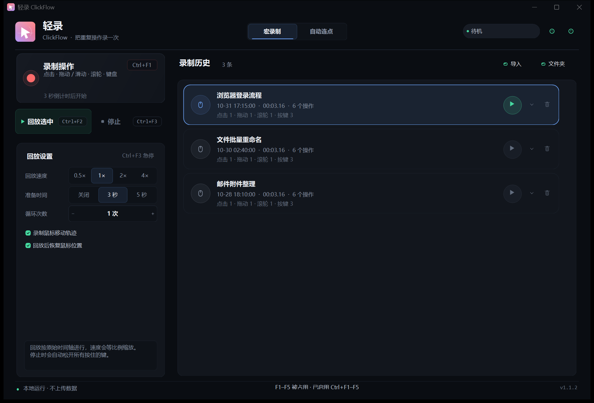
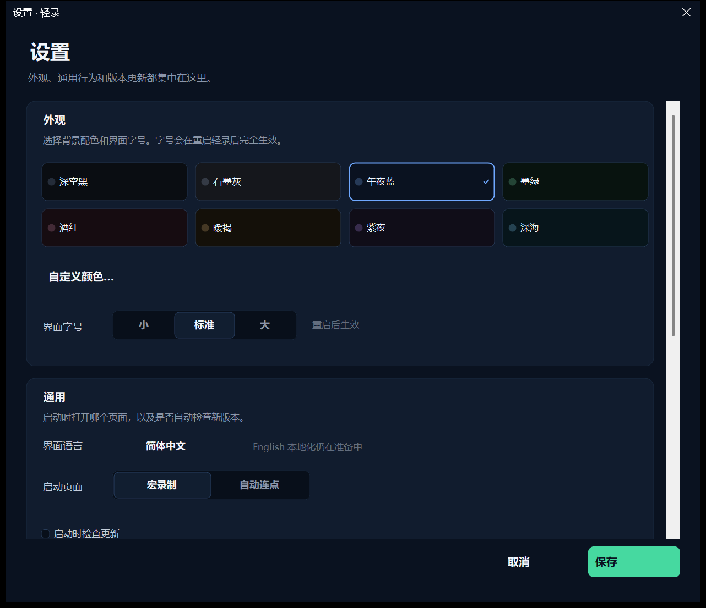
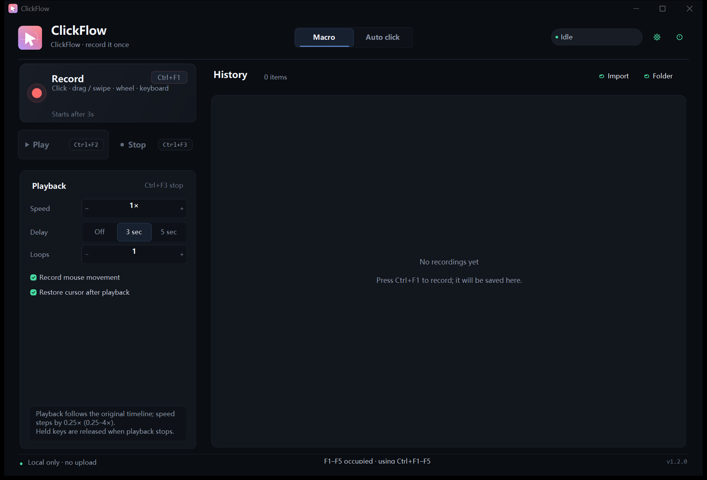
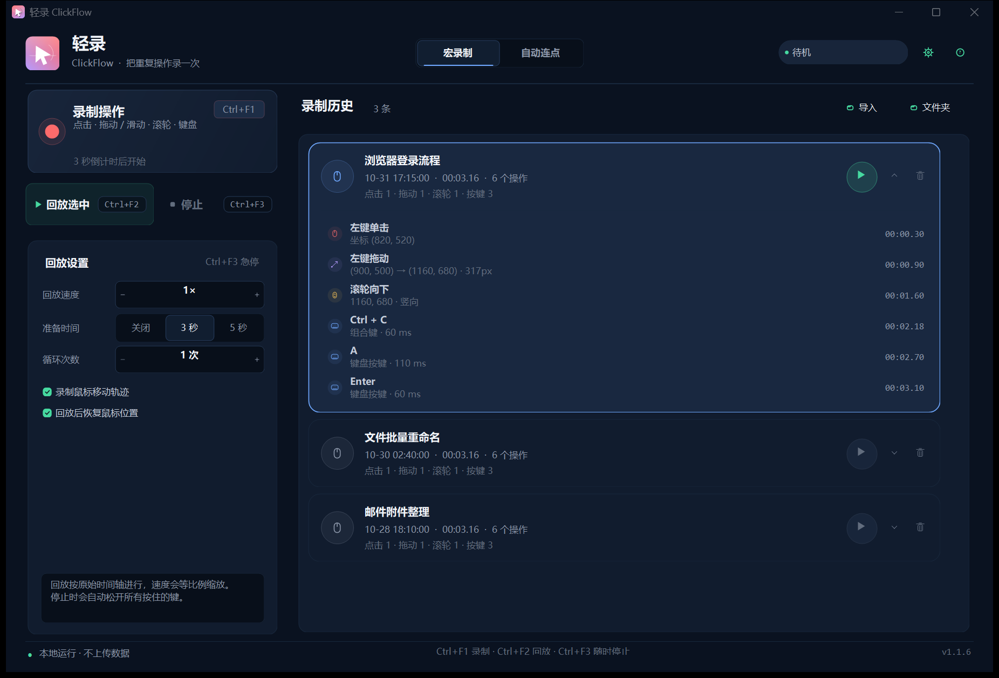
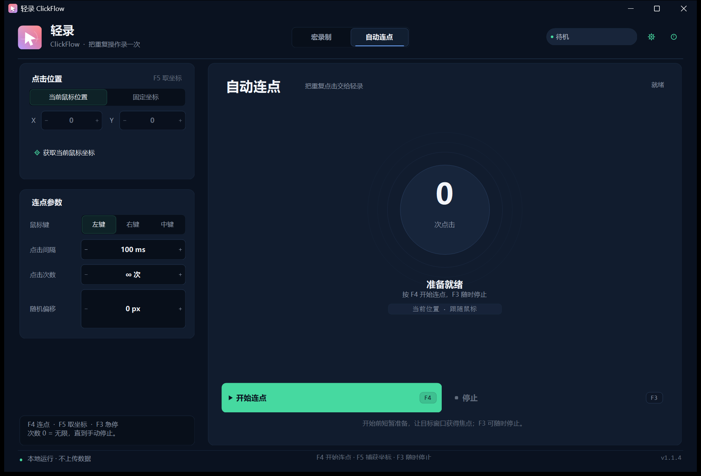

# 轻录 ClickFlow

**把重复操作，录一次就好。**

轻录是一个 Windows 桌面端的鼠标 / 键盘录制回放工具。它可以把点击、拖动（滑动）、滚轮和键盘操作录成一条时间轴，按原始节奏回放；也内置自动连点、录制历史和背景配色。







## 1.2.1 页面切换性能修复

- 切换“宏录制 / 自动连点”时暂停父级布局，去掉重复的强制 `PerformLayout` 和重复状态刷新。
- 修复自动连点视图在空闲时每 80ms 被无条件重绘的问题；现在只有状态真正变化才重绘。
- 修复录制卡片提示、状态组件同类无效刷新。
- 历史卡片尺寸没变化时不再重复布局。
- 页面切换更轻量，低配机器上不会再出现明显停顿。

## 1.2.0 完整中英双语

- 设置中心新增真正的语言切换：**简体中文 / English**，保存后重启生效。
- 主界面、录制历史、帮助、错误提示、设置窗口、系统对话框和操作详情均已资源化。
- 首次启动默认简体中文；现有用户的语言设置保持不变。
- 修复英文模式下播放按钮被截断、主题色块名称对比度不足、设置色块最后一行被裁切的问题。

## 1.1.6 连续倍速

- 回放速度改为可输入的数字步进器：每次 **0.25×**，范围 **0.25×–4×**。
- 连续覆盖 0.25× / 0.5× / 0.75× / 1× / 1.25× / 1.5×…，也可以直接输入任意两位小数。
- 循环次数、连点次数、间隔等数字框支持直接点击输入。

## 1.1.5 倍速、循环输入与主题扩展

- 回放速度增加 **0.25×**，档位为 0.25× / 0.5× / 1× / 2× / 4×。
- 循环次数、连点次数、间隔等数字框支持**直接点击输入**，不再只能点箭头。
- 新增 **纯白 / 暖白 / 极光渐变 / 晨曦渐变 / 薄荷渐变** 主题，支持整套浅色文字与控件配色。
- 设置中心增加“录制鼠标移动轨迹 / 回放后恢复鼠标位置”选项。
- 浅色主题下自动切换窗口标题栏、正文、弱化文字、强调色和快捷键标签对比度。

## 1.1.4 界面细节修复

- 设置窗口底部“取消 / 保存”改为居中文字，并增加右侧安全边距，避免被窗口边缘或滚动条裁切。
- 设置卡片增加高度和间距，滚动区域留出右侧空间，减少标签与滚动条重叠。
- 全局检查无图标按钮的文字对齐：无图标时居中，有图标时保持左对齐和快捷键标签布局。

## 1.1.3 新增设置中心

- 右上角调色盘换成**齿轮设置按钮**，不再弹出会崩溃的右键菜单。
- 设置窗口包含：背景配色 / 自定义颜色、界面字号、启动页面、启动时检查更新、数据目录、版本检查与发布页。
- 背景配色保存后立即生效；字号在重启后生效。
- 修复点击配色按钮时 `ContextMenuStrip` 已释放导致的崩溃。

## 1.1.2 修复

- 修复回放时键盘按键没有反应：键盘钩子误用了鼠标的 `LLMHF_INJECTED` 标志，导致回放注入的键盘事件被输入锁定器当成物理按键拦掉。现在改用键盘专用的 `LLKHF_INJECTED`。
- 同时修复录制时方向键、右侧 Ctrl、Win 等扩展键被误判为注入事件而不记录的问题。
- 保留 1.1.1 的鼠标录制、快捷键标签居中与按钮排版修复。

## 功能

- **全局录制**：鼠标左键 / 右键 / 中键 / 侧键、拖动与滑动、滚轮、键盘按键与组合键。
- **录制历史**：每次停止录制都会自动保存为一条历史记录，可折叠查看具体操作，选中后单独回放。
- **删除即清理**：删除历史记录时会同时删除对应的本地 `.cfmacro` 文件，不会只留下“看不见的垃圾文件”。
- **播放输入锁定**：回放时阻断键盘和鼠标按键/滚轮，避免误触干扰；F3、Esc 或点击顶部急停区域仍可停止。
- **按时间轴回放**：保留原始操作间隔，支持 0.25×、0.5×、1×、2×、4× 速度，循环次数可直接输入 1–999。
- **自动连点**：当前位置或固定坐标、点击间隔、次数（0 为无限）、随机偏移。
- **设置中心**：背景配色、界面字号、中英双语、启动页面、启动时检查更新、数据目录与版本检查集中在一个窗口。
- **背景配色**：深色、纯白、暖白与渐变预设 + 自定义背景色，选择后立即生效并保存。
- **轻量**：历史列表只加载元数据，展开某条记录时才读取操作详情；不把全部宏常驻内存。
- **纯本地运行**：不需要联网，不上传任何操作数据。





## 下载与运行

从 GitHub Releases 页面下载最新的 `ClickFlow-...-win-x64.zip`，解压后运行 `ClickFlow.exe`。

- 推荐下载 **self-contained** 版本：不需要安装 .NET 运行时。
- 免安装、无管理员权限、无注册表写入。
- 数据默认放在程序旁边的 `data` 文件夹（便携模式），删掉整个文件夹即可彻底清理。
- 如果使用本地框架依赖构建，则需要 .NET 10 Desktop Runtime x64。

> **关于 Windows 安全提示**：未签名的 EXE 从网络下载后可能触发 SmartScreen“未知发布者”。这不是程序需要管理员权限，而是 Windows 对未签名可执行文件的常规提示。彻底消除该提示需要代码签名证书；发布流程见 [发布到 GitHub](#发布到-github)。

## 快捷键

默认只使用 **F1–F5**，不占用 F6 及以上功能键：

| 快捷键 | 作用 |
| --- | --- |
| `F1` | 开始 / 停止录制 |
| `F2` | 开始 / 停止回放（需先选中一条历史记录） |
| `F3` | 紧急停止（录制 / 回放 / 连点全部停止） |
| `F4` | 开始 / 停止自动连点 |
| `F5` | 捕获当前鼠标坐标 |
| `Esc` | 取消倒计时 / 停止当前操作 |
| `Ctrl+H` | 打开帮助 |
| `Ctrl+O` | 导入外部宏文件 |

如果 F1–F5 被其他软件占用，轻录会自动启用 **Ctrl+F1–F5** 作为备用键，并把界面上的快捷键提示切换为实际生效的按键。若连 F3 / Ctrl+F3 都不可用，会尝试用 F6 作为急停备用键。

## 录制历史

1. 按 F1 开始录制，停止后自动进入“录制历史”。
2. 单击某条记录，边框高亮表示选中；只有选中后，右侧 ▶ 按钮才可回放。
3. 点击卡片右侧的展开箭头，可以查看这次录制的点击、拖动、滚轮、按键等具体操作。
4. 点击垃圾桶图标删除记录，会弹出确认，并**同时删除本地文件**。
5. “导入”可以把外部 `.cfmacro` 复制到历史库；“文件夹”可以直接打开数据目录。

## 回放输入锁定

回放开始后，轻录会安装低级输入钩子：

- 阻止物理键盘输入（F3、Esc 除外）。
- 阻止物理鼠标按键和滚轮；非拖动阶段鼠标移动保留，方便把光标移到屏幕顶部的急停条；拖动回放期间同时冻结鼠标移动，避免改变拖动轨迹。
- 回放事件本身（SendInput 标记为 injected）不会被阻挡。
- 急停方式：按 **F3 / Esc**，或点击屏幕顶部的 **停止** 区域。
- 回放结束、取消或出错时会自动卸载钩子；即使程序异常退出，Windows 也会在进程结束时释放钩子。

## 背景配色

点击右上角调色盘图标：

- 深空黑、石墨灰、午夜蓝、墨绿、酒红、暖褐、紫夜、深海。
- “自定义背景…”可以选任意颜色；过亮的颜色会自动压暗，保证文字可读。
- 选择立即生效并保存到 `data\settings.json`。

## 数据位置

便携版：程序目录下的 `data\`：

```
data/
  settings.json
  hotkeys.log          # 本次启动的快捷键诊断
  recordings/
    library.json       # 历史索引（只存元数据）
    rec-*.cfmacro      # 每次录制的原始文件
```

如果你删除某条历史记录，对应的 `rec-*.cfmacro` 也会被删除。把整个 `data` 文件夹删除即可重置轻录。

## 使用边界

- 通过 Windows 标准 `SendInput` 注入，**不能操作管理员权限窗口、UAC 安全桌面、锁屏界面**；需要时请以管理员身份启动轻录。
- 部分游戏、远程桌面或安全软件会拦截模拟输入。
- 录制的是**键盘按键**，不是输入法文本；中文候选框选词不保证逐字复现。
- 回放坐标基于录制时的虚拟桌面像素；更换分辨率、缩放比例或显示器布局后可能偏移。
- 输入锁定期间，非拖动阶段鼠标移动仍可用（用于点击急停）；拖动阶段会冻结鼠标移动。需要绝对停止时使用 F3 / Esc / 顶部急停。

## 从源码构建

需要 .NET 10 SDK：

```powershell
dotnet build ClickFlow/ClickFlow.csproj -c Release
```

产物在 `ClickFlow/bin/Release/net10.0-windows/`。

## 发布到 GitHub

仓库已包含：

- `.github/workflows/build.yml`：推送 / 打标签时自动构建 self-contained Windows 单文件版，打 `v*` 标签会自动创建 Release 并附上 ZIP 和 SHA256。
- `portable.flag` 由工作流写入发布包，用户解压即用，数据留在程序目录。
- MIT License。

**关于“无危险提示”**：GitHub Release 的未签名 EXE 仍可能被 SmartScreen 拦截。要彻底消除，需要购买/申请代码签名证书，并在构建后执行 `signtool sign`。这是 Windows 平台的限制，不是代码能绕过的；请不要通过关闭 SmartScreen 来“解决”。在拿到证书前，建议在 Release 说明中提供 SHA256，并说明“无需管理员权限、无安装器”。

发布步骤：

```powershell
git tag v1.1.0
git push origin v1.1.0
```

GitHub Actions 会自动构建 `ClickFlow-v1.1.0-win-x64.zip` 并上传到 Release。

## 隐私

所有录制、设置和日志只保存在本机 `data` 文件夹。项目不包含联网代码。

## License

MIT
